<!-- HERO BANNER -->

 

<!-- DYNAMIC TYPING HEADLINE -->

 

<!-- QUICK STATUS PILLS & SOCIAL CONNECT -->

  
  
  
  

---

### 🍱 Engineering Pillars & Background `[Bento View]`

<table>
  <tr>
    <td width="50%" valign="top">
      <h3>⚡ Low-Level Systems &amp; Architecture</h3>
      

        Đam mê nghiên cứu kiến trúc máy tính, hệ điều hành và cơ chế quản trị tài nguyên phần cứng. Thích viết code C/C++ tường minh, an toàn bộ nhớ và tối ưu hiệu năng cao.
      

      <ul>
        <li><b>Core:</b> C · C++ · POSIX Systems · Linux</li>
        <li><b>Tập trung:</b> GPU resource scheduling, process management, memory layout.</li>
      </ul>
    </td>
    <td width="50%" valign="top">
      <h3>🤖 Applied AI &amp; Intelligent Tools</h3>
      

        Nghiên cứu ứng dụng trí tuệ nhân tạo và thị giác máy tính vào sản phẩm thực tế. Tối ưu hoá trải nghiệm người dùng với mô hình tương tác thông minh.
      

      <ul>
        <li><b>Core:</b> Computer Vision · AI Conversational Agents</li>
        <li><b>Tập trung:</b> Real-time facial attendance, language learning assistants.</li>
      </ul>
    </td>
  </tr>
  <tr>
    <td width="50%" valign="top">
      <h3>🌐 High-Scale Web &amp; Distributed Backend</h3>
      

        Xây dựng web applications chuẩn hiện đại, giao diện trực quan và kiến trúc backend phân tán đáng tin cậy. Chú trọng tính toàn vẹn dữ liệu và clean architecture.
      

      <ul>
        <li><b>Core:</b> TypeScript · Next.js · Node.js · PostgreSQL · MongoDB</li>
        <li><b>Tập trung:</b> RESTful APIs, reactive state, modular design.</li>
      </ul>
    </td>
    <td width="50%" valign="top">
      <h3>🧠 Algorithmic Craft &amp; Problem Solving</h3>
      

        Lấy nền tảng cấu trúc dữ liệu và giải thuật làm gốc. Thích đọc kỹ đặc tả kỹ thuật (spec), phác thảo luồng dữ liệu trước khi triển khai mã nguồn.
      

      <ul>
        <li><b>Core:</b> Data Structures · Graph Algorithms · Procedural Gen</li>
        <li><b>Tập trung:</b> Game loop, dungeon generation, pathfinding (A*).</li>
      </ul>
    </td>
  </tr>
</table>

---

### 🛠️ Tech Stack &amp; Tooling Matrix

#### Programming Languages

  

#### Frontend &amp; UI Architecture

  

#### Backend, Databases &amp; Cloud

  

#### Systems, DevOps &amp; Development Tools

---

### 🚀 Featured Systems &amp; Flagship Projects

| Project | Tech Stack | Highlights &amp; Architecture | Status |
| :--- | :---: | :--- | :---: |
| 🖥️ **[GPU-Server-Manager](https://github.com/hoquan2007/GPU-Server-Manager)** | `C` · `Systems` | Bộ điều phối và lập lịch tài nguyên GPU cấp thấp, phân bổ tiến trình tính toán tối ưu phần cứng. | `Active` |
| 🤖 **[QEnglish](https://github.com/hoquan2007/QEnglish)** | `TypeScript` · `Next.js` · `AI` | Nền tảng hội thoại tiếng Anh ứng dụng AI tương tác thời gian thực, hỗ trợ phản xạ ngôn ngữ. | `Active` |
| 📷 **[face-attendance](https://github.com/hoquan2007/face-attendance)** | `TypeScript` · `Computer Vision` | Hệ thống điểm danh thông minh qua nhận diện khuôn mặt trực tiếp với độ trễ thấp trên nền web. | `Active` |
| ⚔️ **[Shadow-Collapse](https://github.com/hoquan2007/Shadow-Collapse)** | `TypeScript` · `Algorithms` | Tựa game procedural dungeon crawler vận hành thuật toán sinh bản đồ ngẫu nhiên & tìm đường A*. | `Active` |

 

↳ Xem danh sách tất cả các dự án công khai khác: [QMusic](https://github.com/hoquan2007/QMusic) · [ResearchAI](https://github.com/hoquan2007/ResearchAI) · [SOLO-GAME](https://github.com/hoquan2007/SOLO-GAME) · [ProjectChess](https://github.com/hoquan2007/ProjectChess) · [Web-xem-phim](https://github.com/hoquan2007/Web-xem-phim) · [Xem toàn bộ 20+ Repositories →](https://github.com/hoquan2007?tab=repositories)

---

### 📊 Real-Time GitHub Telemetry &amp; Analytics

<table>
  <tr>
    <td width="50%" align="center" valign="middle">
      
    </td>
    <td width="50%" align="center" valign="middle">
      
    </td>
  </tr>
  <tr>
    <td colspan="2" align="center">
      
    </td>
  </tr>
</table>

---

### 🐍 Contribution Activity Skyline

<picture>
  <source media="(prefers-color-scheme: dark)" srcset="https://raw.githubusercontent.com/hoquan2007/hoquan2007/output/github-snake-dark.svg" />
  <source media="(prefers-color-scheme: light)" srcset="https://raw.githubusercontent.com/hoquan2007/hoquan2007/output/github-snake.svg" />
  
</picture>

↳ Snake graph được tạo tự động hàng ngày qua GitHub Actions (<code>Platane/snk@v3</code>) trên nhánh <code>output</code>.

---

### 🎯 Current Mission &amp; Engineering Philosophy

<table>
  <tr>
    <td width="50%">
      <h4>🎯 Trọng Tâm Hiện Tại</h4>
      <ul>
        <li><b>Đang học:</b> Cấu trúc dữ liệu &amp; Giải thuật chuyên sâu, Cơ chế Kernel Linux.</li>
        <li><b>Đang xây dựng:</b> Các ứng dụng hệ thống C và tính năng nâng cao cho QEnglish.</li>
        <li><b>Đang khám phá:</b> Tối ưu hóa mô hình AI biên (Edge AI) và kiến trúc GPU Compute.</li>
      </ul>
    </td>
    <td width="50%">
      <h4>💡 Triết Lý Kỹ Thuật</h4>
      <blockquote>
        <b>"LEARN. BUILD. BREAK. UNDERSTAND. IMPROVE."</b>
          
        <i>Đọc kỹ đặc tả kỹ thuật, bắt đầu từ những module cốt lõi, chấp nhận thử thách để tìm ra gốc rễ vấn đề, và hoàn thiện giải pháp với tiêu chuẩn cao nhất.</i>
      </blockquote>
    </td>
  </tr>
</table>

---

### 📬 Connect With Me

  
  &nbsp;
  
  &nbsp;
  

 

⚡ Thiết kế và xây dựng theo phong cách <b>Modern Bento Grid &amp; High-End Tech</b> · Tối ưu hiệu năng 100%

