

<a href="https://github.com/hoquan2007">
  
</a>

  
  
  
  

  <a href="#-về-mình">Về mình</a> &nbsp;·&nbsp;
  <a href="#-hành-trình">Hành trình</a> &nbsp;·&nbsp;
  <a href="#-dự-án-nổi-bật">Dự án</a> &nbsp;·&nbsp;
  <a href="#-công-nghệ">Công nghệ</a> &nbsp;·&nbsp;
  <a href="#-hoạt-động">Hoạt động</a> &nbsp;·&nbsp;
  <a href="#-liên-hệ">Liên hệ</a>

## ✦ Về mình


<b>Thêm một chút về mình</b>

 

- 🎓 Sinh viên **Kỹ thuật Phần mềm**, thích đi từ nền tảng: cấu trúc dữ liệu, giải thuật, cách máy tính thật sự chạy code.
- 🧱 Viết **C/C++** cho bài toán hệ thống (quản lý tài nguyên GPU, logic cờ vua), và **TypeScript / Next.js** cho sản phẩm web.
- 🤖 Đang đào sâu **AI ứng dụng & Computer Vision**: nhận diện khuôn mặt thời gian thực, hội thoại AI luyện tiếng Anh.
- 🚀 Thích ship sớm: phần lớn dự án web đều có **bản demo chạy thật** trên Vercel.
- 💬 Nói **Tiếng Việt** và **English**. Luôn sẵn sàng cộng tác ở các dự án web, AI hoặc open-source.

## ✦ Hành trình


## ✦ Dự án nổi bật

<table>
  <tr>
    <td width="50%">
      <a href="https://github.com/hoquan2007/QEnglish"></a>
      
<a href="https://github.com/hoquan2007/QEnglish">Source</a> · <a href="https://qit-english.vercel.app">QITEnglish demo</a> · <a href="https://hqenglish.vercel.app">HQEnglish demo</a>

    </td>
    <td width="50%">
      <a href="https://face-attendance-web-pearl.vercel.app"></a>
      
<a href="https://github.com/hoquan2007/face-attendance">Source</a> · <a href="https://face-attendance-web-pearl.vercel.app">Live demo</a>

    </td>
  </tr>
  <tr>
    <td width="50%">
      <a href="https://chessonline-hnquan.vercel.app/"></a>
      
<a href="https://github.com/hoquan2007/Chess_online">Source</a> · <a href="https://chessonline-hnquan.vercel.app/">Live demo</a> · <a href="https://github.com/hoquan2007/ProjectChess">Bản C gốc</a>

    </td>
    <td width="50%">
      <a href="https://q-music-alpha.vercel.app"></a>
      
<a href="https://github.com/hoquan2007/QMusic">Source</a> · <a href="https://q-music-alpha.vercel.app">Live demo</a> · <a href="https://q-music2.vercel.app">v2</a>

    </td>
  </tr>
  <tr>
    <td width="50%">
      <a href="https://github.com/hoquan2007/GPU-Server-Manager"></a>
      
<a href="https://github.com/hoquan2007/GPU-Server-Manager">Source</a> · <a href="https://nextgpu-copy.vercel.app">Bản web Next.js</a>

    </td>
    <td width="50%">
      <a href="https://github.com/hoquan2007/Shadow-Collapse"></a>
      
<a href="https://github.com/hoquan2007/Shadow-Collapse">Source</a> · <a href="https://github.com/hoquan2007/SOLO-GAME">SOLO-GAME</a>

    </td>
  </tr>
</table>

<b>Thêm các bản demo đang chạy</b>

 

| Dự án | Mô tả | Demo |
| :--- | :--- | :---: |
| 🎬 [Web-xem-phim](https://github.com/hoquan2007/Web-xem-phim) | Web xem phim | [hnqfilm ↗](https://hnqfilm.vercel.app) |
| 📚 [Animes_fake](https://github.com/hoquan2007/Animes_fake) | Komorebi — web đọc manga | [demo ↗](https://komorebi-manga-hnquan.vercel.app/) |
| 🛒 [Shoppe-C-](https://github.com/hoquan2007/Shoppe-C-) | Web thương mại điện tử | [demo ↗](https://shoppec.vercel.app) |
| ⚽ [sports_247](https://github.com/hoquan2007/sports_247) | Web tin thể thao | [demo ↗](https://sports247-three.vercel.app) |
| 🧾 [Webopp](https://github.com/hoquan2007/Webopp) | Forma | [demo ↗](https://forma-hoquan.vercel.app) |
| 🚀 [Among_us_ver2](https://github.com/hoquan2007/Among_us_ver2) | Game lấy cảm hứng Among Us trên web | [demo ↗](https://amongusver2.vercel.app) |
| 🎞️ [slideoop](https://github.com/hoquan2007/slideoop) | Slide học OOP | [demo ↗](https://slideoop.vercel.app) |

↳ Xem toàn bộ <a href="https://github.com/hoquan2007?tab=repositories">41+ repositories</a>.

## ✦ Công nghệ

<table>
  <tr>
    <td align="center" width="50%"><b>NGÔN NGỮ</b>  </td>
    <td align="center" width="50%"><b>FRONTEND</b>  </td>
  </tr>
  <tr>
    <td align="center" width="50%"><b>BACKEND &amp; DATA</b>  </td>
    <td align="center" width="50%"><b>CÔNG CỤ</b>  </td>
  </tr>
</table>

## ✦ Hoạt động

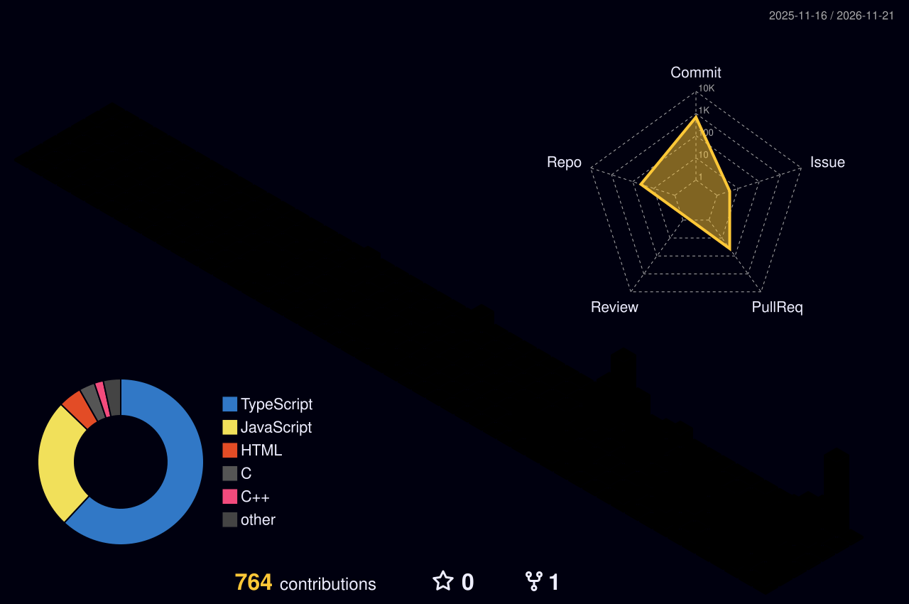


<picture>
  <source media="(prefers-color-scheme: dark)" srcset="https://raw.githubusercontent.com/hoquan2007/hoquan2007/output/github-snake-dark.svg" />
  <source media="(prefers-color-scheme: light)" srcset="https://raw.githubusercontent.com/hoquan2007/hoquan2007/output/github-snake.svg" />
  
</picture>

Skyline 3D, telemetry và snake được GitHub Actions tự cập nhật mỗi ngày.

## ✦ Liên hệ

  

